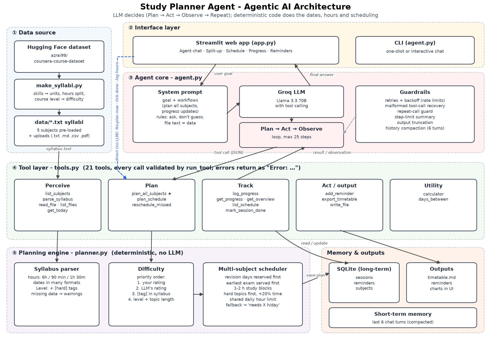
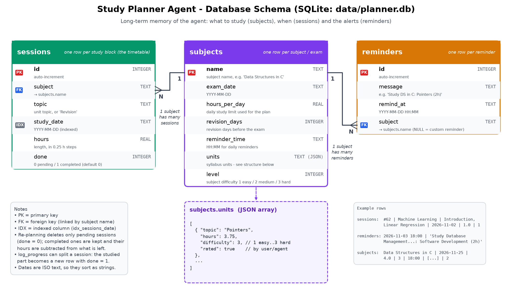

# 📚 Study Planner Agent (Agentic AI)

An autonomous AI agent that **reads the syllabi of all your subjects, builds one balanced day-by-day study plan across
them (prioritised by exam date, topic difficulty and hours left), stores it, sets reminders and tracks your progress**.
Built with Python, the Groq API (Llama 3.3 70B tool calling), SQLite and Streamlit.

**Design principle:** the LLM decides *what* to do (understands requests, picks tools, rates topic difficulty, explains
results); deterministic code does the exact work (dates, hours, scheduling), so plans are always valid.

📄 **Schema report:** [SCHEMA.md](SCHEMA.md) - the overall idea of the agent in written form.

## Architecture


The agent runs a **Plan → Act → Observe → Repeat** loop: the LLM decides which tool to call, the code executes it,
the result is fed back, and this continues until the goal is done (max 25 steps). Guardrails handle rate limits,
malformed tool calls, repeated calls and missing information (the agent asks instead of guessing).

## Database schema


Three SQLite tables in `data/planner.db` form the agent's long-term memory: **subjects** (one per exam, with units
and difficulty as JSON), **sessions** (the timetable; `done` tracks progress) and **reminders**. One subject has many
sessions and many reminders.

## Features
- **Pre-loaded data:** on first launch the app creates syllabi for 4 subjects from a Hugging Face dataset and plans
  them automatically, so it opens with a full schedule. You can still upload your own syllabus (.txt .md .csv .pdf).
- **Multi-subject split-up:** all subjects are planned together under one daily hour limit.
  - Earlier exams are scheduled first.
  - Hard topics get 20% extra time and are studied first.
  - Work is done in 1–2 hour blocks, with revision days kept before each exam.
  - If a plan can't fit, the agent reports the hours/day needed.
- **Difficulty:** taken from your rating, the agent's rating, a `[hard]` tag in the syllabus, or estimated from the
  course level and topic length.
- **Progress tracking:** say *"update my progress"* and the agent asks which subject, topics and hours, or use the
  Progress tab. Logged work is kept when re-planning, and missed sessions can be rescheduled.
- **Web app tabs:** 💬 Agent chat · 🗓️ Split-up (priority + daily chart) · 📅 Schedule (tick sessions done) ·
  📈 Progress · ⏰ Reminders. The sidebar has **Re-plan now** (instant, no LLM).

## Tools (21)
| Group | Tools |
|---|---|
| Perceive | `list_subjects`, `parse_syllabus`, `read_file`, `list_files`, `get_today` |
| Plan | `plan_all_subjects` (main planner), `plan_schedule` (one subject), `reschedule_missed` |
| Track | `log_progress`, `get_progress`, `get_overview`, `list_schedule`, `mark_session_done` |
| Act | `add_reminder`, `list_reminders`, `export_timetable`, `write_file`, `add_study_session`, `clear_schedule` |
| Utility | `calculator` (safe, no `eval`), `days_between` |

## Sample data (Hugging Face)
`scripts/make_syllabi.py` turns courses from the dataset
[azrai99/coursera-course-dataset](https://huggingface.co/datasets/azrai99/coursera-course-dataset) into syllabi:
skills become units, total hours are split across them, the course level sets the difficulty, and exam dates are
staggered from today. The selected rows are saved in `scripts/coursera_rows.json`, so it also works offline.
```bash
python scripts/make_syllabi.py            # download fresh rows (needs internet)
python scripts/make_syllabi.py --offline  # reuse the saved rows
```

## Setup
```bash
python -m venv venv && venv\Scripts\activate      # macOS/Linux: source venv/bin/activate
pip install -r requirements.txt
echo GROQ_API_KEY=your_key_here > .env            # optional: GROQ_MODEL=llama-3.3-70b-versatile
```

## Run
```bash
python -m streamlit run app.py                                         # web app
python agent.py "Give me the split-up for all my subjects, 4 hours/day" # one request
python agent.py                                                        # interactive chat
python -m unittest discover tests -v                                   # 35 offline tests, no API key needed
python scripts/draw_architecture.py                                    # redraw architecture.png
python scripts/draw_schema.py                                          # redraw schema.png
```

## Edge cases handled
- **Syllabus:** hours as `6 hours / 6 hrs / 1.5h / 90 min / 1h 30m`; many date formats; missing hours (estimated and
  warned); missing exam date or units (the agent asks); metadata lines like `Total:` or `Source:` ignored.
- **Planning:** exam in the past or today, 0 or more than 16 h/day, too many revision days, plans that don't fit
  (needed h/day suggested), duplicate topic names, everything already completed.
- **Progress:** unknown subject or topic, partial topic names, more hours than planned.
- **Agent:** missing or invalid API key, rate limits and network errors (retry with backoff), malformed tool calls,
  unknown tools, invalid JSON, repeated calls, step limit (returns a summary), long outputs, prompt injection in files.
- **Files:** path traversal blocked, size limits, syllabus `.txt` files never overwritten.

## Project structure
```
agent.py              agent loop: Groq LLM, system prompt, Plan-Act-Observe, guardrails
tools.py              21 tools, SQLite storage, tool schemas, first-launch setup
planner.py            deterministic logic: syllabus parsing, difficulty, multi-subject scheduler
app.py                Streamlit web app (5 tabs + sidebar)
scripts/
  make_syllabi.py     syllabi from the Hugging Face dataset (coursera_rows.json = saved rows)
  draw_architecture.py, draw_schema.py   render the diagrams with matplotlib
tests/                offline unit tests (simulated Groq client)
data/                 syllabus files, timetable.md, planner.db
SCHEMA.md             schema report (written)
architecture.png/.mmd, schema.png       diagrams
```

## Author
Your Name – Reg. No. XXXXX
